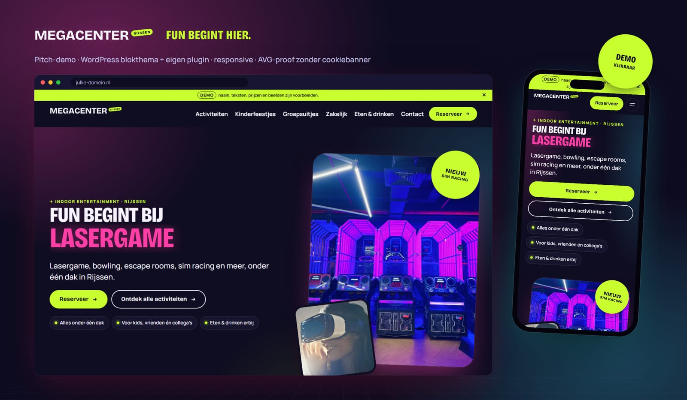

# Megacenter Rijssen – pitch-demo (WordPress)

Een klikbare demo van een complete WordPress-website voor een nieuw indoor entertainment megacenter
in Rijssen. Gebouwd als **eigen blokthema** (`megacenter`) plus **eigen plugin** (`megacenter-core`),
zonder page builder, zonder premium plugins en zonder jQuery. Werktitel: *Megacenter Rijssen*.

> **Demo:** naam, teksten, prijzen, openingstijden en beelden zijn voorbeelden. Er staat bewust een
> wegklikbare demobalk bovenaan (uit te zetten onder **Megacenter → Demo**).



## Live demo (direct in je browser)

| Wat | Link |
|---|---|
| **Website** | [Open de demo](https://playground.wordpress.net/?blueprint-url=https://raw.githubusercontent.com/basvolgers/megacenter-wordpress-demo/main/playground/blueprint-demo.json) |
| **Beheer (CMS)**, direct bij de activiteiten | [Open het beheer](https://playground.wordpress.net/?blueprint-url=https://raw.githubusercontent.com/basvolgers/megacenter-wordpress-demo/main/playground/blueprint-demo-cms.json) |

De demo draait helemaal in je eigen browser via [WordPress Playground](https://wordpress.org/playground/):
niets installeren, geen account nodig. De eerste keer laden duurt 30–60 seconden. Je bent automatisch
ingelogd als beheerder, dus je kunt alles aanpassen. Wijzigingen worden niet bewaard: opnieuw laden geeft
weer een verse demo.

---

## 1. Starten en stoppen

**Eenmalig:** installeer Node.js (LTS). In Windows: open *PowerShell* en typ

```
winget install OpenJS.NodeJS.LTS
```

**Starten (Windows):** dubbelklik op **`start.cmd`**. De eerste keer worden de benodigdheden
geïnstalleerd (een paar minuten). Na ±20 seconden opent je browser vanzelf.

**Starten (Mac/Linux/Git Bash):** `./start.sh` of `npm start`.

| Wat | Adres |
|---|---|
| Website | http://127.0.0.1:9400 |
| Beheer (CMS) | http://127.0.0.1:9400/wp-admin |
| Inloggen | Je bent automatisch ingelogd. Anders: gebruiker `admin`, wachtwoord `password` (standaard testaccount van WordPress Playground, alleen lokaal). |

**Stoppen:** sluit het zwarte venster (of `Ctrl+C`).

Hoe het werkt: [WordPress Playground](https://wordpress.github.io/wordpress-playground/) draait WordPress
(PHP in WebAssembly + SQLite) gewoon via Node.js. Geen Docker, geen XAMPP, geen MySQL. De map
`wp-content/` van dit project wordt rechtstreeks gebruikt; database (`wp-content/database/`) en
uploads blijven bewaard tussen sessies. De eerste start bouwt de demo-inhoud op.

## 2. Wat zit erin

```
wp-content/themes/megacenter/         Thema: theme.json (huisstijl-tokens), templates, parts, patronen, stijlvariaties, CSS/JS, fonts
wp-content/plugins/megacenter-core/   Plugin: activiteiten, velden, instellingen, blokken, formulier, SEO, demo-seeder
playground/blueprint-local.json       Lokale omgeving (Nederlands, permalinks, debug-log, seeden)
playground/blueprint-demo.json        Live demolink via playground.wordpress.net (blueprint-demo-cms.json opent in het beheer)
tools/                                Beeldpijplijn, screenshots, QA, Lighthouse, video, mockup, zips
deliverables/                         Screenshots, video's, mockup, zips, Lighthouse (niet in git; maak ze met de scripts uit §11)
```

**Pagina's:** Home · Activiteiten (overzicht met filters) · 8 activiteitpagina's · Kinderfeestjes ·
Groepsuitjes · Zakelijk · Eten & drinken · Contact & route · Reserveren · Privacy- en cookieverklaring
(concept) · 404 met een knipoog.

## 3. Content aanpassen (voor de opdrachtgever)

Alles gaat via de standaard WordPress-editor, in het Nederlands. Op het dashboard staat een blok
**"Zo pas je je website aan"** met directe links.

- **Teksten en beelden op een pagina:** Pagina's → pagina openen → klik op een tekst of beeld en typ.
  De secties zijn *vergrendeld op inhoud* (contentOnly): je past teksten, knoppen en beelden aan
  zonder dat de opmaak kan breken. Wil je toch een sectie verschuiven? Kies "Bewerken" op de sectie.
- **Een nieuwe pagina in dezelfde stijl:** Pagina's → Nieuwe pagina → kies een complete pagina uit
  "Megacenter: complete pagina's", of voeg losse secties toe via `+` → Patronen → "Megacenter: secties".
- **Activiteit toevoegen (± 1 minuut):** Activiteiten → Nieuwe activiteit → titel, korte intro en
  hoofdbeeld → onder **Activiteit-gegevens** leeftijd, duur, groepsgrootte, prijs, accentkleur,
  highlights en FAQ → Publiceren. De activiteit staat dan automatisch op de homepage, in het
  overzicht, in de bewegende kop ("FUN begint bij …"), in de lichtkrant en bij "Combineer met".
- **Filters (Actie, Samen spelen, …):** Activiteiten → Soorten.
- **Telefoon, e-mail, adres, openingstijden, socials, reserveringslink, demobalk:** menu
  **Megacenter**. Eén keer invullen, overal bijgewerkt (header, footer, contact, Google-gegevens).
- **Menu's:** Weergave → Editor → Navigatie (Hoofdmenu, Footer, Juridisch).
- **Aanvragen:** menu **Aanvragen** (met teller). Elke aanvraag via een formulier komt hier binnen,
  met status *Nieuw / In behandeling / Afgerond*, en wordt ook gemaild.

## 4. Huisstijl wisselen (één klik)

Weergave → Editor → **Stijlen** → kies een variatie:

| Variatie | Bedoeld voor |
|---|---|
| **Nacht** (standaard) | Donker, neon, premium |
| **Daglicht** | Lichte versie, zelfde ontwerp |
| **Arcade** | Alternatief palet (diepblauw + geel/koraal/mint) |
| **Huisstijl opdrachtgever (sjabloon)** | Hier vul je de echte huisstijl in |

Alle kleuren, lettertypes en maten komen uit `theme.json`; de CSS gebruikt alleen die variabelen.
Daardoor zet één bestand de hele site om.

**De huisstijl van de opdrachtgever invullen** in `wp-content/themes/megacenter/styles/huisstijl-opdrachtgever.json`:

| Token (slug) | Wat |
|---|---|
| `base` / `surface` / `surface-2` | Achtergrond en vlakken |
| `contrast` / `muted` | Tekstkleur en gedempte tekst |
| `paper` / `paper-contrast` | Afwisselend (licht) vlak en de tekst daarop |
| `accent-1` … `accent-4` | Vier accentkleuren (één per activiteit, knoppen, stickers) |
| `on-accent` | Tekstkleur op een accentkleur |
| `display` / `body` (fontFamilies) | Koppen- en tekstfont (zelf hosten als `.woff2` in `assets/fonts/`) |

Controleer na het invullen het contrast (minimaal 4,5:1 voor tekst). Het logo vervang je via het
**Site Logo-blok** in de header (Weergave → Editor → Header): het typografische woordmerk is alleen
een vervangbare placeholder.

## 5. Het bestaande reserveringssysteem koppelen

Megacenter → **Reserveren**. Drie mogelijkheden, zonder code:

1. **Embedcode** (widget of iframe van het systeem) plakken → verschijnt op /reserveren/.
   Alleen beheerders met volledige rechten kunnen dit veld wijzigen.
2. **Link** naar de boekingspagina → grote knop op /reserveren/.
3. Per activiteit een **eigen reserveringslink** (Activiteit-gegevens). Leeg = de algemene
   reserveringspagina, met de activiteit al geselecteerd (`/reserveren/?voor=lasergame`).

Alle "Reserveer"-knoppen in header, hero's, kaarten en de mobiele plakbalk volgen deze instellingen.

## 6. Installeren op echte hosting

1. Kale WordPress-installatie (laatste versie, PHP 8.1+).
2. Maak de zips met `npm run zips` (komen in `deliverables/zips/`).
   Plugins → Nieuwe plugin → Uploaden: `megacenter-core.zip` → activeren.
3. Weergave → Thema's → Uploaden: `megacenter-theme.zip` → activeren.
4. Instellingen → Permalinks → "Berichtnaam" → opslaan.
5. Gereedschap → **Demo-inhoud** → "Demo-inhoud aanmaken" (of start leeg en bouw zelf op met de patronen).
   Ook via WP-CLI: `wp megacenter seed` (of `--reset`).
6. Voor productie:
   - Megacenter-instellingen invullen en de **demobalk uitzetten**.
   - Instellingen → Lezen → zoekmachines toestaan (de demo staat bewust op *niet indexeren*).
   - E-mail betrouwbaar laten versturen met een SMTP-plugin (bijv. via de mailprovider).
   - Optioneel: het lichte, eigen aanvraagformulier vervangen door een formulierplugin
     (Gravity Forms, Fluent Forms) als er koppelingen met CRM/nieuwsbrief nodig zijn.
   - Caching (bijv. via de hosting) en een beveiligingsplugin naar keuze. Let op: pagina-caching
     en WordPress-nonces in formulieren gaan prima samen zolang de cache korter dan 12 uur is.
   - Een SEO-plugin (Yoast/Rank Math) is optioneel; de eigen SEO-basis zet zichzelf dan automatisch uit.

## 7. Ontwerpkeuzes

- **Concept "nacht in de arena":** donker, blauwpaars fundament met neonaccenten; lichte "papieren"
  panelen geven ritme. Premium en speels, zonder kinderachtig te worden.
- **Palet:** nacht `#0E0C20`, vlak `#181532`, tekst `#F7F4FF`, papier `#F5F0E6` + vier accenten:
  limoen `#C8FF2E`, magenta `#FF3EA5`, ijsblauw `#3EE8FF`, zon `#FF9A1F`. Elke activiteit krijgt één accent.
  Alle combinaties gemeten op WCAG AA (laagste: magenta op nacht 5,9:1).
- **Typografie:** Bricolage Grotesque (koppen, smal en extra vet: sportief, eigenwijs) + Manrope
  (tekst, rustig en goed leesbaar). Beide OFL, zelf gehost, 2 bestanden, ±100 KB samen.
- **Signatuur:** roterend activiteitwoord in de hero, schuine limoen-lichtkrant, gedraaide stickers
  ("Nieuw", "Favoriet"), grote omlijnde nummering, glow-hover in de accentkleur, subtiele grain-laag,
  neon-perspectiefvloer, schuine CTA-band en een reuzen-outline-slogan in de footer.
- **Beeld:** foto's uit verschillende bronnen worden één geheel via accentverlopen, lichte
  desaturatie en vaste uitsneden. Liever een sfeerbeeld dan een foto die niet past.
- **Conversie:** "Reserveer" altijd zichtbaar (header, hero, kaarten, mobiele plakbalk), arrangementen
  met vanaf-prijs, en voor groepen een laagdrempelig aanvraagformulier ("binnen één werkdag antwoord").
- **Inspiratie (sfeer, niets gekopieerd):** competitive-socialising-merken als Puttshack en Flight Club:
  donkere venues, mensen centraal, feitelijke koppen, opvallende pill-knoppen.

## 8. Kwaliteit (gemeten)

| Check | Resultaat |
|---|---|
| Lighthouse mobiel – home | Performance 84 · Toegankelijkheid 100 · Best practices 100 · SEO 100 |
| Lighthouse mobiel – activiteitpagina | Performance 97 · Toegankelijkheid 100 · Best practices 100 · SEO 100 |
| CLS / TBT | 0 / 0 ms |
| axe-core (WCAG 2.2 AA), 15 pagina's | 0 serious/critical |
| Console-fouten / PHP-meldingen (debug.log) | 0 / 0 |
| Horizontale scroll op 360–1920 px | geen |
| Interne links | 26 gecontroleerd, geen 404 |
| Block editor | 7 pagina's/activiteiten, 0 ongeldige blokken |
| Eigen CSS / JS (ongecomprimeerd) | 58 KB / 5 KB |
| Externe verzoeken bij laden | 0 |

Kanttekeningen: Playground draait PHP in WebAssembly zonder gzip; de serverrespons (TTFB ±0,8–2 s)
drukt de performance-score. Op normale hosting met caching en gzip ligt die hoger. De SEO-score is
gemeten zonder de audit "pagina mag geïndexeerd worden", omdat de demo bewust op *niet indexeren* staat.

**Privacy (AVG):** fonts en beelden staan op de eigen server, er zijn geen trackers of analytics en
geen kaart-embeds (de routeknop opent Google Maps pas na een klik). De site plaatst geen
tracking-cookies, dus **een cookiebanner is niet nodig**.

## 9. Te vervangen door de opdrachtgever

- [ ] Definitieve naam (nu werktitel "Megacenter Rijssen") – Megacenter → Naam
- [ ] Logo (Site Logo-blok) en huisstijl (`huisstijl-opdrachtgever.json`)
- [ ] Adres, telefoon, e-mail, e-mail voor aanvragen
- [ ] Openingstijden en toelichting (vakanties, groepen)
- [ ] Activiteiten: echte namen, teksten, leeftijden, duur, groepsgroottes, prijzen
- [ ] Arrangementen en pakketten met echte prijzen en inhoud
- [ ] Foto's en eventueel video van de eigen locatie (nu vrije stockfoto's, zie CREDITS.md)
- [ ] Reserveringssysteem: embedcode of link (en per activiteit indien gewenst)
- [ ] Sociale media-links (nu de algemene startpagina's van de platforms)
- [ ] Echte Google-reviews (het component staat klaar; nu een duidelijke placeholder)
- [ ] Juridische teksten: privacy- en cookieverklaring (nu concept), eventueel algemene voorwaarden
- [ ] Bereikbaarheid en parkeren
- [ ] Demobalk uitzetten en zoekmachines toestaan bij livegang

## 10. Bekende beperkingen

- E-mail: lokaal in Playground worden mails niet echt verstuurd; aanvragen worden wél opgeslagen.
- De reserveringsmodule is een nette placeholder; er zit bewust geen nep-boekingsflow in.
- Reviews zijn een placeholder; koppeling met Google-reviews volgt na keuze van een dienst/plugin.
- Openingstijden-status ("Nu open") wordt op de server berekend; bij zware pagina-caching kan die
  tot de volgende cache-verversing achterlopen.
- Het formulier is bewust licht (geen bijlagen, geen CRM-koppeling); zie §6 voor de upgrade.
- Afbeeldingen van StockSnap zijn maximaal 960 px breed beschikbaar; voor heel grote schermen zijn
  eigen foto's in hoge resolutie mooier.

## 11. Handige commando's (voor ontwikkelaars)

| Commando | Doet |
|---|---|
| `npm start` | Lokale site starten (zelfde als start.cmd) |
| `npm run build:css` | CSS minimaliseren na wijzigingen (`theme.css` → `theme.min.css`) |
| `npm run images` | Demobeelden downloaden, bijsnijden, WebP + CREDITS.md (eigen beeld van de opdrachtgever: `tools/images.private.json`, alleen lokaal) |
| `npm run screenshots` | Full-page screenshots (390/768/1440) naar `deliverables/screenshots/` |
| `npm run qa` | Console, axe-core, overflow, tap-targets, links, formulier end-to-end |
| `npm run qa:editor` | Pagina's en activiteiten openen in de block editor, ongeldige blokken melden |
| `npm run lighthouse` | Lighthouse mobiel (home + activiteit) naar `deliverables/lighthouse/` |
| `npm run video` | Scroll-video's (desktop + mobiel) als mp4 |
| `npm run mockup` | Presentatiebeeld `deliverables/mockup.png` |
| `npm run zips` | Installeerbare zips van thema en plugin |
| `npm run seed:reset` | Demo-inhoud resetten via de knop in het beheer |

Bronnen en licenties van alle beelden: zie [CREDITS.md](CREDITS.md).
